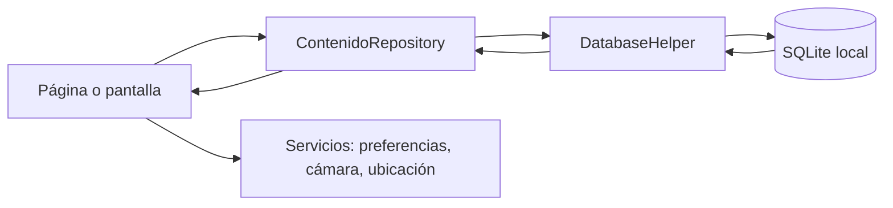
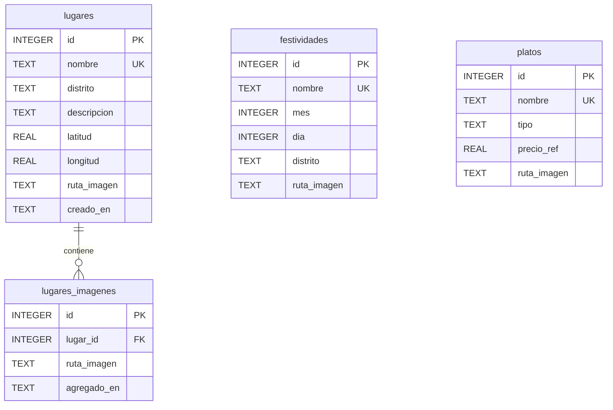

# Informe técnico: Guía turística y cultural del Cusco

**Asignatura:** Desarrollo de Software II (IF616AIN)  
**Institución:** Universidad Nacional de San Antonio Abad del Cusco, Escuela Profesional de Ingeniería Informática y de Sistemas
**Semestre:** 2026-II
**Actividad:** Proyecto 5, Guía Práctica 02, Sesión 7
**Integrantes y roles:** [Completar con los nombres y responsabilidades reales]
**Repositorio configurado:** [Turismo-y-cultura-Cusco](https://github.com/RonaldoTcnJnc/Turismo-y-cultura-Cusco)

> **Estado técnico:** Flutter · SQLite v7 · 4 secciones principales · 39 pruebas aprobadas · análisis estático sin incidencias.

> **Pendiente de entrega:** completar integrantes y aportes reales, agregar capturas propias y comprobar el límite de páginas indicado por la guía. No se inventan datos del equipo ni evidencias.

### Contenido

1. [Resumen del proyecto](#1-resumen-del-proyecto)
2. [Arquitectura del proyecto](#arquitectura-del-proyecto)
3. [Interfaz de la Sesión 6](#2-punto-de-partida-sesión-6-requisito-81)
4. [Objetivo y requerimientos](#3-objetivo-de-la-sesión-7-requisito-82)
5. [Modelo de datos y persistencia](#5-modelo-de-datos-y-persistencia-requisito-84)
6. [Navegación y formulario](#6-contrato-de-navegación-requisito-85)
7. [Mapa, componentes dinámicos y pruebas](#8-sensores-mapa-e-imágenes-requisito-87)
8. [Aceptación y conclusiones](#13-checklist-de-aceptación-del-proyecto-5-requisito-810)

## 1. Resumen del proyecto

El Proyecto 5 convierte la guía turística y cultural del Cusco iniciada en la Sesión 6 en una aplicación Flutter con contenido persistente y consultable. Su arquitectura separa interfaz, reglas de consulta, modelos, servicios y persistencia. La app permite explorar lugares, festividades y platos; buscar por texto; filtrar lugares y festividades; registrar, editar y eliminar contenidos; consultar detalles y favoritos; conservar la sección seleccionada; y ver lugares en un mapa con orden por cercanía cuando hay ubicación disponible.

La persistencia principal se implementa con SQLite. SharedPreferences conserva favoritos, última sección y último filtro. La ubicación se solicita al entrar al mapa y no se almacena. El permiso es opcional: ante una denegación o falta de señal, la lista continúa disponible.

## Arquitectura del proyecto

La arquitectura es una separación por responsabilidades dentro de una aplicación Flutter. Las pantallas componen la experiencia y administran estado visual; los repositorios coordinan las consultas y operaciones de contenido; `DatabaseHelper` es dueño del esquema, las semillas y las migraciones; los servicios encapsulan preferencias, cámara y ubicación. Los modelos tipados evitan que las pantallas tengan que manipular mapas SQLite directamente.

| Capa | Responsabilidad principal | Punto de entrada del código |
|---|---|---|
| Presentación | Construye páginas, pantallas, tarjetas, formularios y estados de carga. | `pages/`, `screens/`, `widgets/` |
| Navegación | Valida rutas y transporta argumentos tipados entre pantallas. | `app.dart`, `navigation/route_arguments.dart` |
| Aplicación/dominio | Representa lugares, festividades y platos; define operaciones CRUD y reglas de consulta. | `models/`, `data/contenido_repository.dart` |
| Persistencia | Abre SQLite, crea tablas e índices, inserta semillas y migra versiones. | `data/database_helper.dart`, `data/database_factory*.dart` |
| Servicios de dispositivo | Encapsula preferencias, sesión de rol, cámara, almacenamiento de fotos y ubicación. | `services/` |
| Configuración compartida | Reúne rutas, límites visuales, textos y reglas de validación. | `utils/` |
| Verificación | Comprueba datos, widgets, navegación, validadores y servicios. | `test/` |

```text
lib/
├── main.dart                         # Inicialización y punto de entrada
├── app.dart                          # MaterialApp y registro de rutas
├── data/
│   ├── database_helper.dart           # Esquema, semillas y migraciones SQLite
│   ├── database_factory*.dart         # Driver de base según plataforma
│   ├── contenido_repository.dart      # Consultas, CRUD, agenda y fotos
│   ├── lugar_repository.dart          # Fachada de lugares
│   ├── festividad_repository.dart     # Fachada de festividades
│   ├── plato_repository.dart          # Fachada de platos
│   └── guide_data.dart                # Datos visuales de la guía
├── models/                            # Contenido, lugar, festividad, plato y UI
├── navigation/                       # Argumentos tipados de las rutas
├── pages/cusco_guide_page.dart        # Explorar, Guardados, Agenda y Perfil
├── screens/                           # Mapa, categoría, detalle, formulario y favoritos
├── services/                          # Preferencias, rol, cámara y ubicación
├── theme/                             # Tema de Material
├── utils/                             # Constantes y validadores
└── widgets/                           # Tarjetas, secciones, calendario, carrusel, etc.

assets/images/                         # Portada, categorías, lugares, fiestas y platos
test/                                  # Pruebas de UI, navegación, servicios y datos
```

El flujo de lectura principal es:



Para una operación de alta o edición, el formulario valida los datos, el repositorio persiste el modelo y la pantalla anterior actualiza su `Future` al regresar si hubo cambios. La navegación usa rutas nombradas y argumentos tipados; el contenido viaja como modelo `Contenido` y las categorías como `TipoContenido`.

## 2. Punto de partida: Sesión 6 (requisito 8.1)

La interfaz conserva los elementos centrales de la guía visual de la Sesión 6:

- Cabecera de exploración con buscador y acceso al mapa.
- Carrusel horizontal de categorías.
- Al tocar una categoría del carrusel se abre su listado; Tradiciones conduce al listado de Festividades.
- Secciones de Lugares, Festividades y Gastronomía con tarjetas de contenido.
- Tarjetas con imagen y etiquetas superpuestas según la categoría.
- Bloque «Evento del mes», calculado a partir de la próxima festividad.
- Barra inferior con cuatro secciones: Explorar, Guardados, Agenda y Perfil.

La pantalla principal usa `IndexedStack` para mantener montadas las pestañas y conservar su estado al cambiar de sección.

## 3. Objetivo de la Sesión 7 (requisito 8.2)

El objetivo es alimentar y consultar la guía con registros guardados localmente, sin depender de datos remotos. El modo Visitante permite explorar, buscar, revisar eventos y guardar favoritos. El modo Colaborador habilita altas, edición y eliminación de contenidos mediante el formulario unificado. El rol se selecciona desde Perfil y solo dura durante la sesión actual. Es un control de flujo local para demostración: no verifica identidad ni sustituye autorización en un backend.

## 4. Requerimientos funcionales (requisito 8.3)

| Código | Requerimiento | Implementación y estado |
|---|---|---|
| RF-5.1 | Almacenar y listar lugares, festividades y platos típicos. | **Implementado.** SQLite tiene una tabla por categoría; las listas se leen desde `ContenidoRepository`. La semilla vigente incorpora 6 lugares, 15 festividades y 5 platos. |
| RF-5.2 | Buscar por texto y filtrar por distrito o mes. | **Implementado según categoría.** La búsqueda consulta nombre y descripción en las tres categorías. Lugares y festividades filtran por distrito; festividades también por mes. Platos no tienen distrito en su modelo. |
| RF-5.3 | Registrar y editar cualquier categoría con formulario unificado. | **Implementado.** Un único formulario adapta los controles al tipo de contenido y precarga los valores durante la edición. |
| RF-5.4 | Ver detalle con imagen, descripción y datos particulares. | **Implementado.** El detalle presenta imagen si existe, descripción y datos específicos: distrito/coordenadas, fecha anual o tipo/precio. |
| RF-5.5 | Marcar favoritos y consultarlos en sección propia. | **Implementado.** Los identificadores de favorito se guardan en SharedPreferences y se muestran en Guardados. |
| RF-5.6 | Navegar entre cuatro secciones conservando su estado. | **Implementado.** La barra inferior tiene cuatro secciones dentro de `IndexedStack`; se restaura la última sección guardada. |
| RF-5.7 | Ubicar lugares en mapa y ordenarlos por cercanía. | **Implementado en Mapa.** Se dibujan marcadores para lugares georreferenciados y la lista se ordena por distancia si hay posición. Sin posición, se ordena alfabéticamente. |
| RF-5.8 | Mostrar «Evento del mes» por proximidad de fecha. | **Implementado y probado.** La pantalla calcula con la fecha/hora local actual del dispositivo (`DateTime.now()`), obtiene la siguiente ocurrencia válida de cada festividad y muestra la fecha futura más cercana, incluyendo el cambio de año. Se actualiza al reanudar la app y al comenzar un nuevo día local. Se interpreta proximidad como próxima fecha futura, no como evento necesariamente dentro del mes calendario actual. |

## 5. Modelo de datos y persistencia (requisito 8.4)

La base de datos `guia_cusco.db` se crea en el almacenamiento privado de la aplicación. El esquema vigente está en **versión 7** (`DatabaseHelper.databaseVersion`) y contiene las tres tablas principales, además de la tabla secundaria de fotos aportadas:

| Tabla | Campos | Restricciones principales |
|---|---|---|
| `lugares` | `id`, `nombre`, `distrito`, `descripcion`, `latitud`, `longitud`, `ruta_imagen`, `creado_en` | `id` autoincremental; nombre obligatorio y único; distrito y descripción obligatorios; latitud nula o entre −90 y 90; longitud nula o entre −180 y 180. |
| `festividades` | `id`, `nombre`, `mes`, `dia`, `descripcion`, `distrito`, `ruta_imagen`, `creado_en` | `id` autoincremental; nombre obligatorio y único; mes entre 1 y 12; día entre 1 y 31; descripción obligatoria. |
| `platos` | `id`, `nombre`, `descripcion`, `precio_ref`, `tipo`, `ruta_imagen`, `creado_en` | `id` autoincremental; nombre obligatorio y único; descripción y tipo obligatorios; precio nulo o no negativo. |
| `lugares_imagenes` | `id`, `lugar_id`, `ruta_imagen`, `agregado_en` | Guarda fotos adicionales de cada lugar; referencia `lugares(id)` con borrado en cascada. |

`creado_en` y `agregado_en` se guardan como fechas ISO 8601. `ruta_imagen` en las tablas principales conserva la imagen de portada. Las fotos que aporta un visitante se insertan en `lugares_imagenes` y se presentan en una galería separada, por lo que no reemplazan la portada. Las migraciones incrementales desde versiones anteriores crean la tabla de fotografías, incorporan festividades y corrigen rutas de imágenes; no eliminan ni recrean las tablas de contenido. La migración v7 actualiza las rutas de las festividades que ahora tienen imágenes específicas. La semilla inicial se inserta en una transacción. Se activa `PRAGMA foreign_keys = ON`; la tabla de fotos usa una clave foránea con borrado en cascada.

### Relaciones y evolución del esquema



`lugares_imagenes` es la única relación entre tablas: un lugar puede tener cero o muchas fotografías aportadas. Festividades y platos no se relacionan mediante claves foráneas con otras tablas. Los favoritos y preferencias de navegación tampoco se guardan en SQLite.

| Versión | Cambio aplicado durante la actualización |
|---:|---|
| 1 | Creación del esquema principal, índices y datos iniciales. |
| 2 | Añade `lugares_imagenes` y su índice para fotos aportadas. |
| 3 | Incorpora festividades próximas sin duplicar nombres existentes. |
| 4 | Actualiza rutas de imágenes asociadas al contenido de festividades. |
| 5 | Corrige rutas de imágenes de lugares, festividades y platos iniciales. |
| 6 | Limpia asignaciones identificadas como incorrectas en festividades. |
| 7 | Asigna las rutas específicas disponibles para Navidad, Año Nuevo, Bajada de Reyes, San Sebastián y Chiaraje. |

Las actualizaciones se ejecutan por nombre de registro y solo cambian los campos necesarios; mantienen los registros creados por el usuario. Las fotos adicionales y los datos de contenido no se borran durante estas migraciones.

### Índices y criterio de búsqueda

Se crean estos índices: `idx_lugares_nombre`, `idx_lugares_distrito`, `idx_festividades_nombre`, `idx_festividades_mes`, `idx_festividades_distrito` e `idx_platos_nombre`. La búsqueda textual construye un patrón `%texto%` y consulta `nombre LIKE ? OR descripcion LIKE ?`; el distrito y el mes se agregan como condiciones parametrizadas. Los valores se envían mediante `whereArgs`, no se concatenan al SQL. Los resultados se ordenan por nombre con `COLLATE NOCASE`.

Los índices por nombre/distrito/mes documentan los campos consultables, aunque una búsqueda con comodín inicial (`%texto%`) normalmente no aprovecha un índice B-tree para acelerar la coincidencia textual. Los filtros de distrito y mes sí usan igualdad y son candidatos a aprovechar sus índices. La unicidad declarada en SQLite distingue mayúsculas/minúsculas con la colación predeterminada.

### Evento del mes

La pantalla principal invoca el cálculo con `DateTime.now()` del dispositivo, en su zona horaria local. El repositorio obtiene los registros de festividades, construye para cada uno la siguiente fecha anual válida desde esa fecha y elige la ocurrencia más próxima. Si una fecha no existe en un año (por ejemplo, un 29 de febrero en un año no bisiesto), ese año se descarta y se busca el siguiente; se limita la búsqueda a ocho años. La pantalla vuelve a calcular al reanudarse desde segundo plano y programa una actualización al inicio del siguiente día local, por lo que no conserva el evento de ayer si permanece abierta. Las pruebas cubren la fecha actual, la comparación de festividades cercanas, la transición de diciembre a marzo y una festividad del mismo día. Las fechas seed de Corpus Christi, Qoyllur Rit’i y Señor de los Temblores son referenciales porque varían cada año; Inti Raymi está registrado el 24 de junio.

SharedPreferences conserva la lista de favoritos (`tipo:id`), la última sección y el último filtro. El perfil no se persiste. En Android, Linux y otras plataformas nativas se selecciona el driver SQLite correspondiente; en web se usa SQLite sobre IndexedDB mediante el adaptador web. La base local no sincroniza datos entre dispositivos o plataformas.

## 6. Contrato de navegación (requisito 8.5)

Las rutas se declaran centralmente y sus argumentos se envían mediante clases tipadas. `onGenerateRoute` comprueba el tipo recibido y presenta una pantalla de ruta no disponible si no corresponde.

| Ruta | Pantalla | Argumentos | Resultado |
|---|---|---|---|
| `/` | Inicio de la guía y cuatro secciones | Ninguno | — |
| `/categoria` | Lista de una categoría | `CategoriaRouteArgs` con `TipoContenido` | `void` |
| `/contenido` | Formulario unificado de alta/edición | `ContenidoFormRouteArgs` con categoría y `Contenido?` | `Contenido?` guardado |
| `/contenido/detalle` | Detalle, favorito, edición y eliminación | `ContenidoDetalleRouteArgs` | `bool?` para indicar cambios |
| `/mapa` | Mapa y lista de lugares | Ninguno | `void` |
| `/favoritos` | Lista independiente de favoritos | Ninguno | `void` |

La app también presenta Guardados como una de las cuatro pestañas principales; `/favoritos` permite abrir la lista como ruta independiente.

## 7. Formulario y validaciones (requisito 8.6)

El formulario se adapta a Lugar, Festividad o Plato. La categoría se elige mediante `SegmentedButton` al crear; al editar, se mantiene fija. Los mensajes explican cómo corregir entradas inválidas.

| Campo | Control y regla implementada |
|---|---|
| Nombre | Obligatorio, entre 4 y 80 caracteres. Se consulta si ya existe en la tabla de la categoría; al editar se excluye el propio ID. Mensaje de duplicado: «Ya existe un contenido con ese nombre.» |
| Categoría | Selección obligatoria mediante segmentos. |
| Descripción | Obligatoria, entre 25 y 500 caracteres. Mensaje mínimo: «La descripción debe tener al menos 25 caracteres.» |
| Distrito | Requerido en lugares; opcional en festividades según el modelo. El selector ofrece los distritos configurados. Mensaje: «Seleccione el distrito.» |
| Fecha | Obligatoria para festividades; se escoge con `showDatePicker` y se almacena mes/día. El selector y validador comprueban una fecha de calendario válida. |
| Latitud y longitud | Opcionales; valores numéricos dentro de −90..90 y −180..180. |
| Precio referencial | Opcional; acepta decimal y debe ser numérico, finito y mayor o igual a 0. |
| Tipo de plato | Obligatorio para platos. |
| Imagen | Opcional/recomendada; se puede tomar con cámara o elegir de la galería. |

El guardado bloquea el botón mientras consulta duplicados y persiste. Los campos se desplazan con el teclado y los controladores se liberan al cerrar la pantalla. Si falla la cámara, la interfaz informa que se puede usar la galería.

## 8. Sensores, mapa e imágenes (requisito 8.7)

La ubicación usa `geolocator`. Antes de solicitar el permiso, el mapa explica que la posición se usa para centrar el mapa y ordenar los lugares, y que no se guarda. Con posición disponible, el mapa se centra en el usuario, muestra distancias y ordena primero los lugares con menor distancia; los lugares sin coordenadas quedan al final. Sin posición, la lista se ordena alfabéticamente y el mapa se centra en Cusco.

Si se deniega el permiso, se desactiva el servicio de ubicación o no se obtiene posición, la lista sigue disponible y no se muestran distancias. Si el permiso está denegado permanentemente, se ofrece abrir Ajustes. El mapa usa tiles de OpenStreetMap y muestra su atribución; requiere conexión para cargar el mapa base y ofrece aviso/reintento si fallan los tiles. La lista es el respaldo funcional cuando no hay tiles.

El reto opcional de aporte fotográfico está disponible también para el Visitante: desde el detalle de un lugar puede pulsar «Fotografiar este lugar» o «Aportar otra fotografía» y capturar una imagen con la cámara. La app guarda el archivo en el almacenamiento privado en plataformas IO (o como URI de datos en web) y añade la ruta a `lugares_imagenes`; la portada del lugar se conserva. La galería muestra las fotos aportadas junto a la imagen original. Esta acción no requiere el modo Colaborador. La cámara también puede utilizarse desde el formulario de contenido, que sí está restringido al modo Colaborador. Las imágenes incluidas en el proyecto deben respetar las atribuciones registradas en `assets/images/ATRIBUTOS.md`.

**Alcance que debe demostrarse:** el mapa contiene la lista ordenada por cercanía, pero la pantalla de lista por categoría «Lugares» no muestra distancias junto a cada elemento. Si la rúbrica interpreta que también deben aparecer allí, esa parte requiere implementación adicional y no debe darse por aceptada solo con el mapa.

## 9. Historias de usuario y aceptación (requisito 8.8)

| Código | Historia | Criterio de aceptación | Estado según código y pruebas |
|---|---|---|---|
| HU-5.1 | Como visitante, quiero buscar lugares, festividades y platos. | Los resultados provienen de la base de datos. | **Implementado.** El repositorio consulta SQLite por nombre o descripción; hay prueba de búsqueda y filtros. |
| HU-5.2 | Como visitante, quiero ver qué evento se celebra próximamente. | El bloque muestra la festividad con fecha futura más próxima. | **Implementado.** El cálculo maneja cambio de año; no es una consulta ordenada por diferencia absoluta de mes. |
| HU-5.3 | Como visitante, quiero ver lugares cercanos a mí. | El mapa y la lista se ordenan por distancia. | **Parcial según el alcance literal.** La lista dentro de Mapa se ordena y muestra distancias al conceder ubicación; la lista de categoría Lugares no muestra distancias. Permisos y GPS real requieren prueba en dispositivo. |
| HU-5.4 | Como colaborador, quiero agregar un plato típico. | El plato aparece en su sección y persiste. | **Implementado en modo Colaborador.** El selector local habilita altas, edición y eliminación; las rutas directas y el formulario también comprueban el rol. El CRUD de plato tiene prueba SQLite en memoria; persistencia tras reiniciar necesita evidencia en dispositivo. No se valida identidad del colaborador. |
| HU-5.5 | Como visitante, quiero guardar mis lugares favoritos. | Los favoritos se conservan entre sesiones. | **Implementado con SharedPreferences.** La persistencia real tras cierre debe demostrarse en el dispositivo de entrega. |
| HU-5.6 | Como visitante, quiero volver a la sección donde estaba. | La sección activa se conserva al navegar o reabrir. | **Implementado con IndexedStack y SharedPreferences.** La restauración está en el código; su prueba integral de reinicio no está documentada con captura. |

## 10. Reparto de roles (requisito 8.9)

La guía propone repartir el trabajo entre modelo/repositorio, interfaz de inicio/estado, formularios/navegación y mapa/informe. Estos son roles de trabajo del equipo, distintos de los modos Visitante y Colaborador disponibles en la app. Completar la tabla con las asignaciones reales del equipo; no se deben inventar nombres ni contribuciones.

| Integrante | Responsabilidad asignada | Aporte realizado |
|---|---|---|
| [Nombre A] | Modelo de las tres tablas, repositorio y búsqueda | [Completar] |
| [Nombre B] | Inicio, secciones y persistencia de pestaña | [Completar] |
| [Nombre C] | Formulario unificado, validaciones y navegación | [Completar] |
| [Nombre D] | Mapa, ubicación, pruebas, informe y evidencias | [Completar] |

Si el equipo tiene menos o más integrantes, ajustar la tabla a la distribución efectiva.

## 11. Componentes dinámicos y manejo de estado

La app no es una maqueta estática: la interfaz se reconstruye cuando cambian datos, filtros, permisos o navegación. El estado se gestiona con herramientas de Flutter (`StatefulWidget`, `setState`, `FutureBuilder`, `ChangeNotifier` e `IndexedStack`); no se incorpora un gestor externo.

| Componente | Cómo se vuelve dinámico |
|---|---|
| `IndexedStack` en la página principal | Cambia entre Explorar, Guardados, Agenda y Perfil conservando las pestañas montadas. SharedPreferences recuerda la última sección. |
| Búsqueda de Explorar | El `TextField` notifica cambios; un temporizador de 300 ms agrupa la escritura y vuelve a consultar las categorías. |
| Tarjetas y listados | `FutureBuilder` representa carga, error, lista vacía y resultados. Las tarjetas abren detalles; «Ver todo» abre el listado completo con sus filtros. |
| Agenda cultural | El repositorio calcula las próximas ocurrencias; la pestaña vuelve a cargar al reanudar la app y programa actualización al siguiente día local. |
| Evento próximo | Se selecciona la fecha futura más cercana, incluso al cruzar el año. El cálculo se refresca al reanudar y al cambiar el día. |
| Formulario | Los campos y validaciones cambian según Lugar, Festividad o Plato. El estado distingue guardado, duplicado, errores y selección de imagen. |
| Rol | `RoleSession` es un `ChangeNotifier` en memoria. Al cambiar a Colaborador habilita las acciones CRUD; Visitante mantiene el modo de consulta. |
| Favoritos | SharedPreferences conserva claves `tipo:id`; la pantalla los resuelve contra el repositorio y permite retirarlos. |
| Mapa | La ubicación actualiza el centro y el orden por distancia; si falla, la lista alfabética sigue disponible. El permiso puede conducir a Ajustes. |
| Aporte fotográfico | Cámara/galería devuelve una imagen que se guarda localmente; el repositorio registra fotos adicionales sin sustituir la portada. |

Las rutas se validan en `app.dart` y reciben argumentos como `CategoriaRouteArgs`, `ContenidoFormRouteArgs` y `ContenidoDetalleRouteArgs`. Al volver de un detalle o formulario, el resultado de navegación indica si corresponde refrescar el listado. La interfaz comprueba `mounted` tras operaciones asíncronas antes de llamar `setState`; también cancela temporizadores y libera controladores al destruir una pantalla.

El rol es únicamente una simulación local para la práctica. No autentica personas ni proporciona autorización frente a un cliente modificado; una versión multiusuario requiere autenticación y reglas de acceso en un backend.

## 12. Pruebas, resultados y evidencias

La validación automatizada se ejecuta con `flutter test` y `flutter analyze`. En esta edición del informe, la suite completa pasó **39 pruebas** y `flutter analyze` terminó con **No issues found**. Las pruebas de datos usan SQLite en memoria y las de interfaz emplean repositorios falsos. La navegación de Agenda al listado completo y la presentación de tarjetas están cubiertas por pruebas de widgets. El APK debug se instaló y ejecutó en el dispositivo Android conectado durante la revisión de las imágenes. Los builds web y Linux no se repitieron para esta versión del informe.

La suite automatizada cubre operaciones CRUD de las tres categorías, semilla, filtros y búsqueda, restricciones e índices, fotos adicionales sin reemplazo de portada, cálculo del evento desde la fecha local, refresco al reanudar y orden de próximas festividades, navegación del carrusel y de Agenda, tarjetas en categorías, validadores, rutas tipadas, roles, preferencias, breakpoints y formato de distancia. La prueba de foto usa un servicio de cámara falso: comprueba el flujo y el almacenamiento separado, pero no usa una cámara física. Las pruebas de ubicación no ejercitan permisos del sistema ni un GPS real; tampoco se identificó una prueba específica de año bisiesto. Los tests de base de datos usan SQLite en memoria y los de interfaz usan repositorios falsos.

Falta realizar y documentar en emulador o teléfono: alta, cierre completo y reapertura para persistencia; edición y eliminación desde el detalle; permiso de ubicación denegado; ubicación disponible y orden/distancias; y mapa con y sin conexión. Guardar capturas reales en `evidencias/`, sin incluir datos personales, y reemplazar estos marcadores:

| Evidencia | Archivo sugerido | Estado |
|---|---|---|
| Lista inicial y datos semilla | `01-lista-y-semilla.png` | [Pendiente de captura real] |
| Alta y validación del formulario | `02-alta-y-validacion.png` | [Pendiente de captura real] |
| Detalle, favorito, edición y eliminación | `03-detalle-y-favorito.png` | [Pendiente de captura real] |
| Mapa con permiso denegado | `04-mapa-sin-permiso.png` | [Pendiente de captura real] |
| Persistencia luego de reiniciar la app | `05-persistencia-tras-reinicio.png` | [Pendiente de captura real] |
| Mapa y lista con tiles disponibles | `06-mapa-con-ubicacion.png` | [Pendiente de captura real] |

## 13. Checklist de aceptación del Proyecto 5 (requisito 8.10)

| Criterio | Verificación actual | Pendiente para aceptación final |
|---|---|---|
| Las tres categorías se almacenan, listan y buscan desde la base de datos. | Implementado; CRUD y consultas tienen pruebas SQLite. | Adjuntar evidencia de ejecución de la app. |
| El «Evento del mes» se calcula por proximidad desde la fecha actual. | Implementado y probado: usa el reloj local, se actualiza al reanudar o al cambiar el día, elige la ocurrencia futura más cercana y cubre el cambio de año. | Captura del bloque en la pantalla de inicio. |
| El carrusel abre la categoría seleccionada. | Implementado y probado para Lugares, Festividades y Gastronomía; Tradiciones abre Festividades. | Captura del listado abierto desde el carrusel. |
| Agenda muestra las próximas festividades y permite ver el listado completo. | Implementado; Agenda ordena por ocurrencia y «VER TODO» abre el listado de Festividades con tarjetas, búsqueda y filtros. La navegación se valida con prueba de widget. | Verificar visualmente el flujo en el teléfono durante la demostración. |
| El formulario adapta campos y valida por categoría. | Implementado; validadores y flujo de duplicidad tienen pruebas. | Captura de alta y errores de validación. |
| El mapa muestra lugares y los ordena por cercanía. | Implementado para lugares con coordenadas cuando hay posición. | Probar GPS/permiso en dispositivo y capturar el resultado. |
| La sección activa se conserva al navegar mediante IndexedStack. | Implementado; pestañas montadas en `IndexedStack` y última sección en preferencias. | Verificar reapertura y adjuntar evidencia si lo exige la rúbrica. |
| Los favoritos persisten entre ejecuciones. | Implementado en SharedPreferences. | Cerrar completamente, reabrir y capturar. |
| El ciclo contenido → detalle → edición funciona sin reiniciar. | Implementado mediante rutas tipadas y retorno de cambios. | Captura del flujo completo en ejecución. |
| El informe explica búsqueda e índices. | Documentado en la sección 5. | Confirmar que la versión exportada queda dentro del máximo de seis páginas. |

## 14. Dificultades y decisiones técnicas

- Se separaron adaptadores SQLite por plataforma para soportar Android, Linux y navegador; en web la persistencia depende del navegador y origen.
- La búsqueda del repositorio usa parámetros SQL para evitar interpolar directamente los filtros en las consultas.
- El cálculo de la siguiente festividad usa fechas concretas, en vez de ordenar por distancia absoluta entre meses, para obtener el evento correcto al cruzar el año.
- Las festividades móviles se incluyen con fechas de referencia; para datos culturales exactos se deben actualizar según el calendario anual.
- En pantallas estrechas se ajustaron dimensiones del calendario y se incluyen pruebas de layout para breakpoints.
- El mapa depende de conexión para los tiles; la lista de lugares queda disponible como alternativa.

## 15. Conclusiones

La Sesión 7 incorpora persistencia SQLite para las tres categorías, operaciones CRUD, búsqueda y filtros, formulario unificado, navegación con estado preservado, favoritos persistentes y consulta de lugares en mapa. Los modos locales Visitante y Colaborador separan las acciones de consulta de las de gestión; además, cualquier visitante puede añadir fotos a un lugar desde su detalle. Estas imágenes se conservan en una tabla separada y no reemplazan la portada. El cálculo del próximo evento cruza correctamente el cambio de año según la prueba automatizada disponible. El sistema de ubicación degrada a una lista utilizable si no se concede el permiso.

La implementación cubre los requisitos funcionales principales, con dos alcances que deben quedar claros: los platos no tienen campo distrito y, por ello, no se filtran por distrito; además, las distancias se presentan en la pantalla Mapa, no en la lista de categoría Lugares. Los roles son una simulación funcional local sin identidad ni autorización en servidor; para un despliegue multiusuario se necesitarían autenticación y permisos respaldados por backend. El aporte de fotos del visitante conserva la portada y requiere prueba con cámara física en un dispositivo. La aceptación final requiere comprobar los flujos reales de permisos y persistencia en dispositivo, agregar las capturas, completar los integrantes y la autoevaluación de la rúbrica oficial, confirmar el nombre exigido del repositorio y comprobar el límite de páginas al exportar.

### Anexo A. Autoevaluación con la rúbrica oficial

Completar los puntajes únicamente después de consultar la rúbrica del curso. No asignar puntajes estimados.

| Criterio | Puntaje máximo según rúbrica | Puntaje del equipo | Evidencia/justificación |
|---|---:|---:|---|
| Persistencia y CRUD | [Completar] | [Completar] | [Completar] |
| Búsqueda y filtros | [Completar] | [Completar] | [Completar] |
| Estado y navegación | [Completar] | [Completar] | [Completar] |
| Formulario y validaciones | [Completar] | [Completar] | [Completar] |
| Sensores y mapa | [Completar] | [Completar] | [Completar] |
| Pruebas, evidencias y documentación | [Completar] | [Completar] | [Completar] |